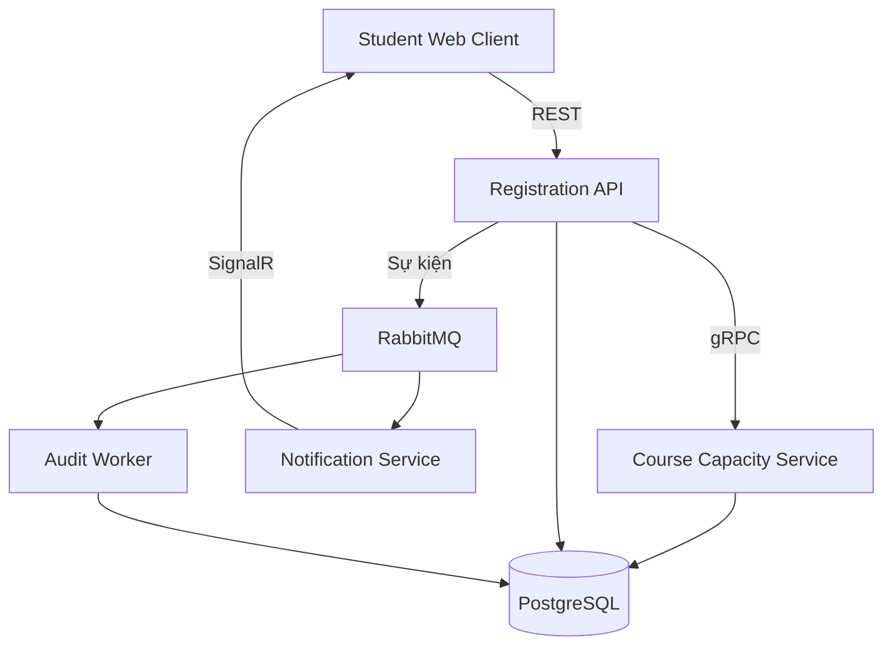

# Thiết kế kiến trúc hệ thống

## 1. Tổng quan

Hệ thống đăng ký học phần thời gian thực được xây dựng
theo kiến trúc phân tán, gồm các service hoạt động
độc lập và giao tiếp qua REST, gRPC và RabbitMQ.

## 2. Các thành phần

### Student Web Client
- Hiển thị danh sách lớp học phần.
- Cho phép sinh viên đăng ký hoặc hủy đăng ký.
- Nhận cập nhật số chỗ qua SignalR.

### Registration API
- Cung cấp REST API cho client.
- Kiểm tra đăng ký trùng.
- Quản lý thông tin đăng ký.
- Gọi Course Capacity Service bằng gRPC.
- Phát sự kiện thay đổi đăng ký qua RabbitMQ.

### Course Capacity Service
- Quản lý sức chứa lớp học phần.
- Kiểm tra lớp còn chỗ.
- Giữ chỗ khi có đăng ký mới.
- Trả chỗ khi hủy đăng ký.
- Đảm bảo số đăng ký không vượt sức chứa.

### Notification Service
- Nhận sự kiện từ RabbitMQ.
- Sử dụng SignalR để gửi số chỗ mới tới client.

### Audit Worker
- Nhận sự kiện từ RabbitMQ.
- Lưu lịch sử đăng ký hoặc hủy đăng ký.

### PostgreSQL
- Lưu thông tin sinh viên.
- Lưu lớp học phần và sức chứa.
- Lưu thông tin đăng ký.
- Lưu lịch sử thay đổi.

## 3. Sơ đồ kiến trúc



## 4. Quy trình đăng ký

1. Sinh viên chọn lớp học phần.
2. Client gửi yêu cầu đến Registration API.
3. API kiểm tra sinh viên đã đăng ký hay chưa.
4. API gọi Capacity Service để giữ chỗ.
5. Capacity Service kiểm tra và cập nhật sức chứa.
6. API lưu thông tin đăng ký.
7. API phát sự kiện RegistrationCreated.
8. Notification Service nhận sự kiện.
9. SignalR gửi thông tin số chỗ mới tới client.
10. Audit Worker lưu lịch sử đăng ký.

Nếu lưu đăng ký thất bại sau khi giữ chỗ, hệ thống
cần thực hiện thao tác trả chỗ bù và ghi log lỗi.

## 5. Quy trình hủy đăng ký

1. Sinh viên gửi yêu cầu hủy.
2. Registration API kiểm tra đăng ký hợp lệ.
3. Hệ thống cập nhật trạng thái đăng ký.
4. Capacity Service thực hiện trả chỗ qua gRPC.
5. API phát sự kiện RegistrationCancelled.
6. Notification Service gửi cập nhật qua SignalR.
7. Audit Worker lưu lịch sử hủy.

## 6. Các yêu cầu cần bảo đảm

- Không đăng ký trùng.
- Không vượt quá sức chứa của lớp.
- Các service có thể chạy độc lập.
- Có logging để theo dõi lỗi.
- Có cơ chế xử lý khi service tạm thời ngừng.
- RabbitMQ phân phối sự kiện tới nhiều subscriber.
- Có Docker Compose cho toàn bộ hệ thống.
```
